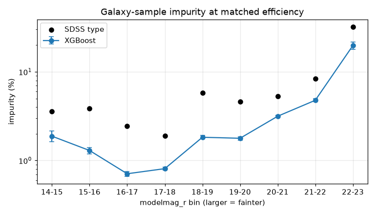

# Star–Galaxy Separation with XGBoost

**A machine-learning model that cuts contamination in SDSS galaxy samples by more than half.**

Telescopes photograph millions of bright dots. Each one is a star (in our own galaxy), a galaxy (far away) or a quasar. Cosmologists need a clean list of galaxies, because stars that sneak in distort measurements of how galaxies cluster.

This project trains an [XGBoost](https://xgboost.readthedocs.io/) model on about 2.2 million SDSS DR9 objects to decide **galaxy or not galaxy** from catalog measurements (shape, brightness, colour). It is judged against the survey's own `type` label, the standard rule it has to beat. The problem setup and the `type` comparison follow Sevilla-Noarbe & Etayo-Sotos (2015), [*Effect of training characteristics on object classification: an application using Boosted Decision Trees*](https://arxiv.org/abs/1504.06776). The modelling, splits and analysis are this project's own, and it is not a replication of the paper.

Everything is in one notebook, [`star_galaxy_xgboost.ipynb`](star_galaxy_xgboost.ipynb), which explains each step in plain language.

## Key result

At the same share of galaxies kept as SDSS `type`, XGBoost lets in **2.21 times fewer non-galaxies** (1.74% impurity against 3.84%, test set of 439,026 objects, used once).



*Lower is better. Black dots are the SDSS `type` rule, the blue line is XGBoost with its 68% interval.*

## Contents

- [How results are judged](#how-results-are-judged)
- [Results](#results)
- [What the experiments show](#what-the-experiments-show)
- [Method in brief](#method-in-brief)
- [Limitations](#limitations)
- [Running it](#running-it)
- [Files](#files)
- [Data and credits](#data-and-credits)

## How results are judged

Two numbers, computed separately in each one-magnitude brightness bin of `modelmag_r` (14 to 23; a smaller magnitude means a brighter object):

- **Efficiency**: of all real galaxies, the percentage kept.
- **Impurity**: of everything called a galaxy, the percentage that is a star or quasar.

The two trade off, so the fair comparison fixes one and measures the other:

1. **Matched efficiency (main test).** In each bin the model's cut-off is set so that it keeps the **same share of galaxies as SDSS `type`**. Then impurity is compared (lower is better).
2. **Impurity cap.** How many galaxies can be kept while impurity stays at or below 1%?

## Results

On the test set, at the same efficiency as SDSS `type`:

| `modelmag_r` bin | Efficiency, `type` (%) | Efficiency, XGBoost (%) | Impurity, `type` (%) | Impurity, XGBoost (%) |
|---|---|---|---|---|
| 14–15 | 99.45 | 99.45 | 3.60 | 1.88 |
| 15–16 | 99.30 | 99.31 | 3.85 | 1.30 |
| 16–17 | 99.58 | 99.56 | 2.46 | 0.71 |
| 17–18 | 99.82 | 99.81 | 1.90 | 0.81 |
| 18–19 | 98.79 | 98.78 | 5.77 | 1.83 |
| 19–20 | 97.93 | 98.05 | 4.61 | 1.78 |
| 20–21 | 98.08 | 98.09 | 5.28 | 3.16 |
| 21–22 | 91.61 | 91.78 | 8.40 | 4.78 |
| 22–23 | 64.66 | 66.80 | 32.18 | 19.81 |
| **all bins** | **98.60** | **98.63** | **3.84** | **1.74** |

- **Overall**, XGBoost's impurity is **2.21 times lower** than SDSS `type`'s at the same efficiency. The bootstrap (resampling the test set, see [Method in brief](#method-in-brief)) puts this between 2.18 and 2.23 in 68% of resamples.
- **Every bin improves**, from about 1.6 times lower in the faintest bin to about 3.5 times lower at 16–17.
- **Faint objects are hard** for both methods. In the 22–23 bin, impurity is still about 20%.
- **At 1% impurity**, XGBoost keeps 96% or more of the galaxies up to magnitude 20, then 64% in the 20–21 bin and 31% in the 21–22 bin. In the faintest bin no cut-off reaches 1%.
- **Quasars** make up 45–69% of the contamination. Counting only stars as contamination lowers impurity (for example from 19.8% to 8.8% in the faintest bin). The main numbers count both.
- **No sign of overfitting.** AUC (1.0 is perfect separation, 0.5 is a coin flip) is 0.9984 on train, 0.9957 on validation and 0.9956 on test. The test score is close to the validation score, so the model is not just memorising the training data.

## What the experiments show

| Question | Finding |
|---|---|
| **Does tuning help?** | Yes. On the validation set, the typical impurity across bins is 5.09% for SDSS `type`, 2.53% for XGBoost with default settings and 2.21% after tuning. |
| **Which information matters?** | Validation impurity: shape alone 6.2%, shape plus concentration 4.8%, shape plus magnitudes 2.7%, colours plus magnitudes 2.4%, all features 2.2%. The most important single feature is `concentration` (`psfmag_r - modelmag_r`), well ahead of `lnlstar_r`, `petror50_r` and `mrrcc_r`. |
| **How much labelled data is needed?** | Impurity falls from about 5.4% with 1,000 training objects to about 2.3% with 1.3 million, and the curve had not flattened. The model already beats SDSS `type` after a few thousand objects. |
| **What if training data only covers bright objects?** | The faint end suffers. Training only on objects brighter than r = 19.5 leaves the 21–22 bin at about 23% impurity, against about 5% for the full training set. Training down to r = 21.5 nearly matches the full set. |
| **Should stars and galaxies be balanced?** | No. Reweighting them to count equally gave 2.26%, against 2.21% for the natural mix, so the natural mix is kept. |

The notebook also contains the calibration check, the feature-importance plot (using SHAP, a method that shows how much each feature pushed a prediction), the full impurity-versus-efficiency curve per bin and the quasar breakdown. All figures are in `outputs/figures/` and all tables in `outputs/results/`.

## Method in brief

| Step | What was done |
|---|---|
| **Data** | 2,195,173 SDSS DR9 objects that have a spectrum, which gives the trusted class (`GALAXY`, `STAR` or `QSO`). Duplicate sky positions are dropped (46 rows). The unmeasurable value `-9999` becomes missing, which XGBoost handles itself. |
| **Features (45)** | 8 shape measurements, 20 magnitudes (5 filters measured 4 ways), 16 colours (differences between neighbouring filters) and 1 concentration. `type` and `class` are never used as features. |
| **Split** | 60% train, 20% validation, 20% test. Random with a fixed seed (42) and balanced by class and brightness bin. The row numbers are saved so any rerun uses the same split. |
| **Tuning** | 40 random combinations of tree depth, minimum leaf weight, learning rate, row and feature sampling and regularisation. The best three are retrained with three seeds each, and the best average wins. The number of trees is set by early stopping on the validation set. |
| **Thresholds** | Set on the validation set, then frozen. The test set plays no part in choosing them. |
| **Error bars** | Bootstrap: the test set is resampled 1,000 times within each bin, and the spread of the results shows how uncertain they are. |

## Limitations

- Only objects that were given a spectrum have a trusted label, and spectra were taken for targeted objects. Performance on faint objects may be optimistic for the full photometric catalog.
- Overall numbers depend on the brightness mix of this sample, so the per-bin numbers are the more meaningful ones.
- The brightest and faintest bins have the fewest objects, so their error bars are widest.
- The bootstrap treats the frozen thresholds as fixed, so their own uncertainty is not included.
- Quasars count as contaminants. This convention changes the numbers.

## Running it

```bash
python3 -m venv .venv
.venv/bin/pip install -r requirements.txt
# put the catalog at data/sdss_dr9_sg.csv (not included, see below), then:
.venv/bin/jupyter nbconvert --to notebook --execute --inplace --ExecutePreprocessor.timeout=-1 star_galaxy_xgboost.ipynb
```

- **Python and packages.** Developed with Python 3.14. The versions in `requirements.txt` are the ones it was tested with, each capped at the next major release.
- **Run time.** The full run takes about 15 minutes on an RTX 4060 laptop GPU. By default XGBoost trains on the GPU. If you have no NVIDIA GPU, set `DEVICE = "cpu"` in the setup cell, which will be slower.
- **Data.** It is not in this repository (about 680 MB). It is public on Hugging Face at [nevilcp/sdss-dr9-star-galaxy](https://huggingface.co/datasets/nevilcp/sdss-dr9-star-galaxy), where the dataset card describes every column. Download it with:

  ```bash
  mkdir -p data
  curl -L -o data/sdss_dr9_sg.csv https://huggingface.co/datasets/nevilcp/sdss-dr9-star-galaxy/resolve/main/sdss_dr9_sg.csv
  ```

  The notebook expects a CSV at `data/sdss_dr9_sg.csv` with one row per object and these columns: `ra`, `dec`, `class`, `type`, the magnitudes `petromag_`, `modelmag_`, `psfmag_` and `fibermag_` in each of the filters `u`, `g`, `r`, `i`, `z`, and the shape columns `petrorad_r`, `petror50_r`, `petror90_r`, `lnlstar_r`, `lnlexp_r`, `lnldev_r`, `me1_r`, `me2_r` and `mrrcc_r`.

## Files

| Path | Contents |
|---|---|
| `star_galaxy_xgboost.ipynb` | The whole analysis, with outputs from the last run |
| `requirements.txt` | Python dependencies with version bounds |
| `outputs/figures/` | The plots shown in the notebook |
| `outputs/results/` | Result tables as CSV (final comparison, frozen thresholds, tuning trials and more) |
| `outputs/models/xgb_final.json` | The trained model (not tracked in git, rebuilt by the notebook) |

## Data and credits

The data comes from [SDSS](https://www.sdss.org/) Data Release 9. Please acknowledge SDSS when you use it, following the [SDSS citation guidelines](https://www.sdss4.org/collaboration/citing-sdss/). The problem setup follows Sevilla-Noarbe & Etayo-Sotos (2015), linked above.
